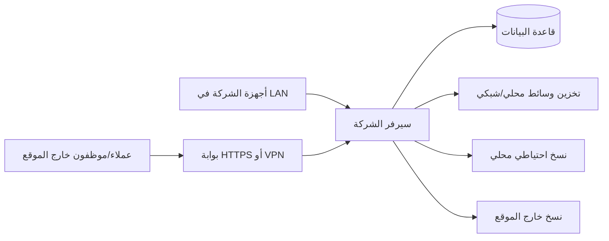

# الوثيقة المعمارية والهندسية

## 1. خط الأساس مقابل البنية المستهدفة

**خط الأساس الحالي المرفق (RC4 Pilot):** تطبيق Python مع HTTP server محلي، SQLite، ملفات HTML/CSS/JS، وواجهات `/`, `/admin/`, `/merchant/`. يتضمن وحدات للحجر الأمني، تجار قطع الغيار، حسابات/قيود تجريبية، ونسخ احتياطي.

**البنية الإنتاجية المستهدفة المقترحة:** Modular Monolith عبر API خادمي موحد، PostgreSQL قاعدة مصدر حقيقة، تخزين وسائط محلي/شبكي أو Object Storage، واجهة عميل PWA، واجهة إدارة منفصلة، بوابة تاجر منفصلة، مهام خلفية للنسخ والإشعارات وانتهاء الحجوزات، ومراقبة خارجية. يمكن اختيار Next.js/Drizzle من المرشح التاريخي أو تحويل خط الأساس، لكن القرار يتطلب مراجعة تقنية وتقدير تكلفة قبل الترحيل. لا تُشغّل نسختين منفصلتين كأنهما قاعدة بيانات واحدة.

## 2. مخطط طبقات النظام

```mermaid
flowchart TD
  C[واجهة العملاء / PWA] --> TLS[HTTPS / بوابة الوصول الآمن]
  A[تطبيق الإدارة المنفصل] --> TLS
  M[بوابة التاجر] --> TLS
  T[بوابة الفني والنقل عند اعتمادها] --> TLS
  TLS --> API[API + مصادقة + تفويض + تحقق]
  API --> BIZ[خدمات الأعمال: كتالوج، حجوزات، طلبات، مالية، خدمات]
  BIZ --> DB[(قاعدة بيانات المصدر]
  BIZ --> MED[وسيط الملفات: حجر ثم فحص ثم نشر]
  MED --> STORE[(تخزين الوسائط المحلي / كائنات]
  BIZ --> AUD[سجل تدقيق ومراقبة]
  DB --> BK[عامل النسخ الاحتياطي]
  STORE --> BK
  BK --> LOCAL[(نسخة محلية مشفرة]
  BK --> CLOUD[(مخزن خارجي محمي/غير قابل للتغيير)]
  BK --> REPORT[تقارير مقروءة محدودة]
```

## 3. مبادئ التصميم

- Modular Monolith أفضل كبداية من Microservices معقدة؛ حدود الوحدات يجب أن تكون واضحة.
- API الخادم هو الحاجز الأمني؛ لا تتصل واجهات العملاء أو التاجر مباشرة بقاعدة البيانات أو قرص SSD.
- مصدر حقيقة واحد لكل كيان مالي ومخزوني. لا تكتب قاعدتان محليّة وسحابية دون بروتوكول مزامنة وفصل تعارضات.
- مفاتيح وأسرار الإنتاج في مدير أسرار أو متغيرات بيئة محمية، لا في المصدر أو تطبيق العميل.
- مهام الحساسية العالية تنفذ بخدمات خلفية قابلة لإعادة المحاولة مع idempotency.
- الوسائط منفصلة منطقيًا عن بيانات المنتجات، وسجل البيانات يحوي معرف/بصمة/مسارًا وليس اعتمادًا على مسار مكشوف.
- قاعدة بيانات الإنتاج لا توضع على SSD قابل للفصل كقرص تشغيل وحيد. يمكن استخدام SSD للوسائط المؤرشفة أو نسخة محلية إضافية؛ يجب مراقبة الانفصال والمساحة والصحة.

## 4. النشر المحلي والهجين



الوضع المحلي لا يعني إهمال الإنترنت؛ الوصول الخارجي يجب أن يتم ببوابة آمنة، ولا يفتح منفذ قاعدة البيانات أو مشاركة القرص على الإنترنت. عند انقطاع الإنترنت تستمر العمليات الداخلية بقدر ما تسمح به البنية، ثم تُصفّ تغييرات النسخ/الإشعارات للمزامنة. يجب إظهار حالة المزامنة وعدم الادعاء بنسخ سحابي فوري أثناء الانقطاع.

## 5. تخزين الملفات والعزل

شجرة مرجعية مقترحة قابلة للتعديل: `01_Categories_Media`, `02_Equipment_Videos`, `03_Products_Images`, `04_Spare_Parts/Merchant_1..3`, `05_System_Backups`, `06_Security_Blackbox`, `07_3D_Models`, `08_Service_Documents`, و`00_Quarantine`. يجب ضبط المسار من الإعدادات وعدم تثبيته في الكود. التاجر لا يحصل على جلسة نظام تشغيل تسمح له بتصفح بقية الأقراص؛ يُدار المحتوى من بوابة محدودة. إذا خصص قرص مادي لكل تاجر، لا يعد ذلك عزلًا كافيًا وحده إذا كان القرص مركبًا وقابلًا للكتابة من الحساب المصاب.

## 6. أداء وتوسع

- CDN/تحويل صور عند السماح بالوسائط السحابية؛ أو thumbnails محلية إذا ظل التخزين محليًا.
- Video Range واختبار سرعة الشبكة وعدد المشاهدات المتزامنة.
- فهارس على product/category/status/merchant/store/created_at/reservation expiry.
- Pagination في قوائم الإدارة والتقارير.
- مراقبة CPU/RAM/disk latency/space/db size/backup lag/errors.
- اختبارات حمل على حجم حقيقي قبل إطلاق عام.

## 7. قرار الانتقال إلى PostgreSQL

المرشح التاريخي يصف PostgreSQL وDrizzle، لكن تطبيق RC4 المرفق يعمل على SQLite. لا يتم تحويل المسار بمجرد تغيير connection string: يلزم مخطط ترحيل، أنواع مبالغ دقيقة، قيود وتفرد، تحويل التواريخ، قفل حجوزات ذرّي، ترحيل بيانات، واختبارات رجوع. قرار قاعدة الإنتاج النهائي مطلوب قبل بناء التشغيل التجاري متعدد المستخدمين.
