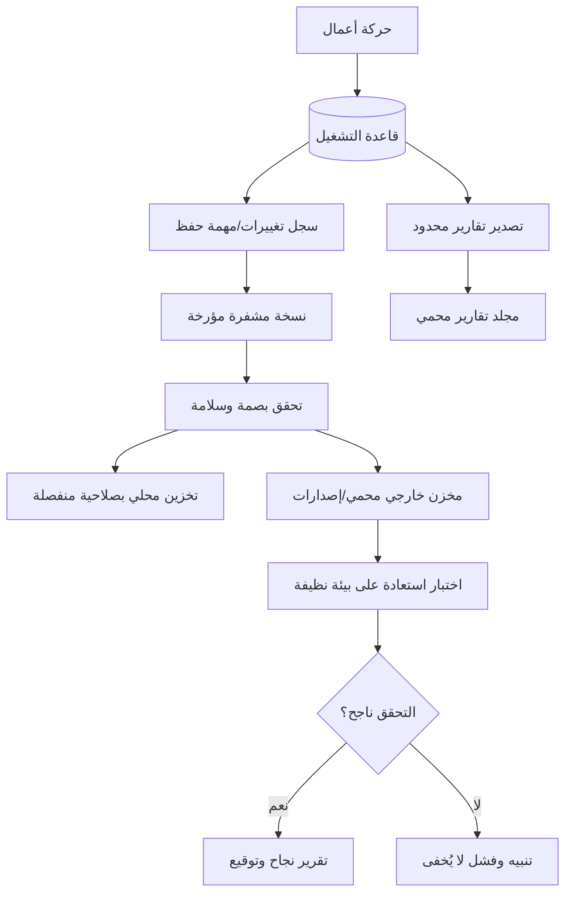

# سياسة النسخ الاحتياطي والتعافي من الكوارث — BCDR

## الهدف

يمكن استعادة التطبيق والبيانات من نسخة خارج النظام المتضرر دون إعادة إدخال كل العمل يدويًا. الأولوية للسجلات المحاسبية وحركات المبيعات والحجوزات والمخزون وبيانات الشركة والتجار، مع الاحتفاظ بالوسائط المهمة بحسب سعة التخزين والتكلفة.

## تصنيف النسخ

A. **نسخة استعادة تشغيلية مشفرة:** قاعدة البيانات وسجلاتها وإعدادات آمنة وإصدارات الترحيل.  
B. **سجل تغييرات/نسخ متقاربة:** لتقليل الفاقد بين النسخ الكاملة؛ يعتمد التطبيق النهائي على محرك DB وقياس RPO.  
C. **تقارير مستقلة مقروءة:** CSV/PDF/JSON محدود الصلاحيات، للتقارير المالية والتشغيلية، وليس بديلًا عن قاعدة البيانات.  
D. **وسائط:** صور وفيديو ومستندات وأصول 3D مهمة مع manifest وبصمات ومسارات مرجعية. يمكن رفعها وفق مستويات أهمية/تكرار مختلفة.  
E. **نسخة خارج الموقع محمية:** تخزين يدعم الإصدارات والاحتفاظ أو القفل غير القابل للتغيير، بصلاحيات منفصلة.  
F. **نسخة مفتاح الاستعادة:** خارج حزمة النسخ وخارج الجهاز التشغيلي، مع إجراءات وصول مزدوجة ومخزن أسرار آمن. فقد المفتاح يعني أن النسخة المشفرة قد تصبح غير قابلة للفك.

## تدفق العملية

## سياسة أولية قابلة للتعديل

| نوع البيانات | تكرار مقترح | الغرض |
|---|---|---|
| سجل المعاملات المالية/تغييرات DB | مستمر/متقارب زمنياً بحسب تقنية DB | أقل فقد ممكن |
| نسخة كاملة لقاعدة البيانات | يوميًا على الأقل، وأقرب حسب حجم العمل | استعادة baseline |
| تقارير مقروءة | يوميًا وبعد الإقفال المالي | مرجع مستقل |
| صور وفيديو منشورة | بعد التحقق من النقل/التعديل، مع تكرار أقل حسب الأهمية | تقليل التكلفة مع حماية الأصول المهمة |
| إعدادات وإصدارات المصدر | عند كل إصدار معتمد | إعادة بناء متطابقة |
| اختبارات استعادة | شهريًا مبدئيًا وبعد تغيير جوهري | إثبات قابلية الاسترجاع |

القيم النهائية لا تعتمد قبل تحديد RPO/RTO مع المالك وإجراء قياسات واقعية. RPO هو مقدار البيانات الأقصى الذي نقبل فقده، وRTO المدة المستهدفة لإعادة الخدمة. مثال قرار مقترح للمراجعة وليس ضمانًا: RPO للدفاتر ≤ 15 دقيقة وRTO للبوابة الأساسية ≤ 4 ساعات؛ يجب إثبات ذلك على العتاد والمزود الحقيقي قبل اعتماده.

## سياسة مساحات التجار

- تصدير مستقل لكل متجر يحتوي بيانات ذلك التاجر فقط، لا قاعدة الشركة الكاملة.
- وجهة نسخ مستقلة لكل تاجر أو bucket/prefix مع IAM policy فصلية ومفاتيح منفصلة عند الحاجة.
- إشعار البريد/Telegram يحتوي حالة النسخ ووقت الإنجاز والبصمة أو رابطًا موقتًا، لا أسرارًا ولا بيانات حساسة غير مشفرة.
- التاجر لا يستطيع حذف نسخ الشركة ولا استعادة نسخة تجعله يكتب فوق مصدر الشركة.
- قد يكون لكل تاجر قرص SSD منفصل، لكنه ليس عزلًا كاملًا وحده. الأقراص المتصلة والقابلة للكتابة من الجهاز المصاب قد تُشفّر جميعًا؛ يلزم فصل حسابات التشغيل وتقييد الوصول، ونسخ غير متصلة/immutability.

## Runbook للاستعادة

1. **احتواء:** عزل الجهاز/حساب الخدمة المصاب وإيقاف المزامنة التي قد تنقل التشفير أو الحذف.
2. **تحديد نقطة الاستعادة:** اختيار نسخة قبل الحادث، مراجعة سجل التنبيهات والتغييرات وتاريخ الفحص.
3. **التحقق من النسخة:** SHA-256، حجم، توقيع/بيانات manifest، وفكها إلى مجلد مستقل دون الكتابة على التشغيل.
4. **بيئة نظيفة:** تثبيت نسخة نظام معروفة سليمة، تحديثها، تدوير الأسرار/المفاتيح والجلسات، وإغلاق سبب الدخول.
5. **استعادة البيانات:** القاعدة أولاً ثم الملفات والمراجع والإعدادات غير السرية وفق الدليل؛ لا تستعد ملفات تنفيذية مشبوهة دون فحص.
6. **مطابقة:** أعداد الطلبات والفواتير والقيود المتوازنة والمخزون والتجار والحجوزات. راجع العمليات الواقعة في الفترة بين آخر نسخة والحادث.
7. **فحص أمني:** التأكد من فحص الملفات، والصلاحيات، ومراقبة التخزين، وسلامة النسخ.
8. **موافقة الإعادة للخدمة:** توقيع المدير والمراجع المالي عند تأثر المال.
9. **ما بعد الحادث:** سبب جذري، تغيير سياسات، وتقرير زمن RPO/RTO الفعلي والدروس المستفادة.

## ضوابط عدم الفشل

- لا تحفظ مفتاح التشفير الوحيد بجوار النسخة.
- لا تمنح حساب السيرفر صلاحية حذف Object Lock/النسخ التاريخية.
- النسخ المحلية ليست كافية إذا تعرضت الأقراص جميعها للحادث نفسه.
- النسخ المتزامنة وحدها ليست كافية؛ الحذف قد يتزامن معها. يلزم Versioning/immutability ونسخ تاريخية.
- اختبار النسخ ليس فقط التأكد من أن الملف موجود، بل استعادته وتشغيل فحوص البيانات.
- تقرير CSV قد يحمل بيانات شخصية ومالية ويحتاج تشفيرًا وصلاحيات ومدة احتفاظ.
